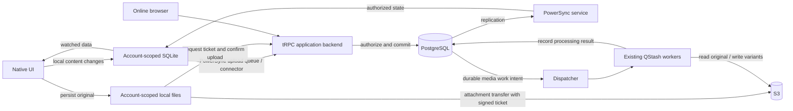

# Offline-first architecture

Status: shared native scenes, SQLite text/media workflows, attachment storage,
server acceptance, and recovery are implemented locally as of 2026-10-25. Live
development browser text/photo sync has passed. Physical-device and packaged
offline acceptance remain pending. See the latest checkpoint below; earlier
checkpoints preserve the evidence available at that time.

This document connects the decisions from our architecture discussion. **Agreed** means a product decision from that discussion. **Recommended** means a concrete engineering choice proposed here to make those decisions work. **Verify** means an assumption with an experiment attached; it is not a proven capability of this app.

## 1. Outcome and boundaries

**Agreed:** a returning user should be able to work on locally available content without thinking about connectivity. Native content changes start with durable local storage, online or offline. The same operation continues toward server acceptance when connectivity and authorization permit.

- Native mobile and desktop: create text notes, add photos/videos, edit text, move content, and request removal offline. Media bytes are added or removed, not collaboratively edited.
- Read locally retained content offline. A photo/video never downloaded, or evicted from the cache, needs a connection to download again. Offline support does not promise a complete copy of every home.
- Browser: intentionally online-only for this iteration; failed saves show an error. This is a scope choice, not a browser limitation.
- First sign-in requires connectivity. A previously signed-in account can continue offline without an additional expiration timer. Explicit logout hides its content until that same account signs in again.
- Distinguish **saved on this device**, **pending sync**, and **accepted by the server**. A media item can be accepted while its thumbnail/poster is still processing.
- Ordinary concurrent edits use last-server-applied-write-wins, with accepted text revision history. Deletion remains guarded by a revision check.
- Demo workload: one or two simultaneous users. Measure representative behavior before adding infrastructure or optimizing.

**Working scope assumption:** home creation, invitations, membership changes, and account administration remain online. Our offline discussion established content workflows, not an offline administration protocol. This boundary should be explicit in the feature scope before implementation.

Accepted limits: another device cannot see an offline-only change; a disconnected device cannot discover revoked access; device loss or uninstall can destroy unsynced work. Diagnostic logs cannot reconstruct that work. No guarantee of transfers continuing while the operating system suspends or terminates the app; reopening must resume them.

## 2. Components and ownership

PowerSync documents a backend write path and a separate service-to-client read path. We supply the backend connector and application rules; adoption does not replace those responsibilities. [PowerSync backend integration](https://docs.powersync.com/configuration/app-backend/client-side-integration)

| Owner                   | Responsibility and authoritative information                                                                                                                        |
| ----------------------- | ------------------------------------------------------------------------------------------------------------------------------------------------------------------- |
| Native shell            | Offline startup, account lifecycle, SQLite/file adapters, and platform permissions.                                                                                 |
| Local SQLite            | Retained user view, unsynced changes, operation context, local outcomes, and attachment transfer state. Sole durable copy of work that has not reached the backend. |
| Local files             | Original unsynced media and evictable downloaded media, scoped to the account. File paths never become shared content.                                              |
| PowerSync               | Deliver database mutations through our connector and reconcile local tables with authorized server state.                                                           |
| tRPC backend            | Authenticate each request; check current membership and target ownership; validate allowed fields; apply conflict and idempotency rules.                            |
| PostgreSQL              | Canonical accepted content, permissions, revisions, tombstones, operation receipts, and durable media work intent.                                                  |
| S3                      | Private original/derived bytes. PostgreSQL determines whether an object belongs to accepted content.                                                                |
| Workers                 | Restartable thumbnail/poster generation and eventual cleanup, with outcomes recorded in PostgreSQL.                                                                 |
| Client policy functions | Map explicit backend outcomes to retry, sign-in, confirmation, preservation, or discard behavior.                                                                   |

Client code cannot choose its actor identity, mark an upload verified, assign canonical revisions, or bypass authorization by submitting a home ID. A sync endpoint must validate a small set of domain operations, not expose arbitrary table writes.

### Repository placement

Keep tRPC contracts in `packages/api`, validation in `packages/validators`, pure policy rules in `packages/domain`, and server persistence/migrations in `packages/db`. Keep S3 work in `packages/media`, publishing/signatures in `packages/queue`, and service orchestration in `packages/api`. Shells supply platform adapters.

**Recommended:** once both native shells need shared client persistence, introduce one client-only `packages/offline` package for local schema, mutations, sync coordination, and outcome handling. It must not import server implementations. Typed tRPC calls remain the API boundary; no parallel handwritten HTTP client. Confirm dependency/lint changes when implementing this package.

The repository currently mandates remotely loaded native UI. Offline cold startup requires an explicit evolution of that convention: bundle the content UI and required assets locally while keeping server routes remote. Update the repository architecture skill and affected decisions during that structural implementation. This design document does not change those rules or runtime code.

## 3. Durable objects and success boundaries

The implementation needs these logical objects; exact table names can follow the chosen SDK integration:

| Object               | Required information                                                                                                                                |
| -------------------- | --------------------------------------------------------------------------------------------------------------------------------------------------- |
| Content record       | Stable client-created ID, home/board, content fields, server revision, and lifecycle/tombstone state.                                               |
| Mutation             | Stable operation identity, target, changed fields, and guarded-delete baseline where applicable. Preserve identity across retries and app restarts. |
| Operation receipt    | Actor-scoped identity, request fingerprint, accepted/rejected result, resulting revision. Reuse with a different payload is invalid.                |
| Text revision        | Accepted text plus actor, operation identity, server order/time, and record revision.                                                               |
| Local attachment     | Stable asset ID, account/home, local file path, expected bytes/type, transfer state, and associated content ID.                                     |
| Remote asset         | Same asset ID, server-owned object key, verified original status, and independent variant status.                                                   |
| Local policy outcome | Operation identity, reason, user-visible resolution state, and preserved text when the policy requires it.                                          |

Use the PowerSync mutation queue for database changes rather than adding a competing database upload queue. Attachments need their own transfer state because bytes live outside SQLite. Capture durable operation context through supported SDK metadata/previous-value facilities; validate its exact mapping in the first slice. [Custom conflict resolution](https://docs.powersync.com/handling-writes/custom-conflict-resolution)

There are three different completion boundaries:

1. **Local save:** SQLite change and queued mutation commit together. For media, the durable original must exist first; then its attachment record and content reference commit together. Only then show saved locally.
2. **Server acceptance:** authorization, mutation, revision/history, and operation receipt commit in one PostgreSQL transaction. Only then acknowledge acceptance. Media additionally requires verification of its uploaded original.
3. **Derived work complete:** thumbnail/poster processing succeeds. Failure here must not falsely report that the original was never saved.

There is no shared transaction across the filesystem, SQLite, S3, PostgreSQL, and QStash. Restartable states and durable work records bridge those boundaries.

## 4. Text create/edit and reconciliation

1. Alice creates a stable note ID or edits an existing note. The local mutation changes only the intended fields and records its operation context.
2. SQLite commits the local change and queued mutation. The UI reads local data and shows pending sync.
3. After reconnect, the connector obtains valid credentials. The backend checks current membership on every write; an earlier client check is insufficient.
4. The backend serializes changes to the target row. It checks operation receipts, validates the operation, applies the allowed patch, increments the canonical revision, records accepted text history, and records the result atomically. Membership revocation and write authorization need a defined database serialization order so a stale pre-check cannot authorize a later write.
5. The client records the outcome and completes the delivered queue transaction only after a definitive result. Timeouts retain the same operation for retry.
6. PowerSync distributes canonical state. Alice and Bob render watched local data; missed SSE notifications are irrelevant to this native data path.

The upload queue is ordered, backend conflict behavior is application-owned, and operation identifiers can support deduplication. Our chosen rule is per-field last-server-applied-write-wins, rather than comparing device clocks. [PowerSync conflict handling](https://docs.powersync.com/handling-writes/handling-update-conflicts)

**Example:** Alice changes text while Bob moves the note. Their patches preserve both changes. If both change text, the last newly applied server operation wins; the earlier accepted text remains in history. If Alice's response was lost, retrying her already accepted operation returns its receipt and does not overwrite Bob's later edit again.

History restoration is a new authorized edit. History protects accepted text versions; it does not magically recover unsent keystrokes or terminally rejected edits. Multiple logical fields that form one value, such as `(x, y)`, must be patched atomically together.

## 5. Deletion, archive, and explicit outcomes

The current design deliberately combines LWW editing with guarded removal:

- Matching revision: apply the deletion/removal atomically and record its receipt.
- Changed revision: return `DELETE_REQUIRES_CONFIRMATION`; show the current item and require a new user action with a new operation ID.
- Already deleted: successful no-op for an authorized caller.
- Edit of a deleted item: `ITEM_DELETED`; never silently resurrect the old ID.
- Missing identity is not permission to upsert an edit into a new row. Keep creates distinct from edits.

Keep tombstones and receipts for this demo rather than guessing a safe expiry. An arbitrarily long offline period means a time-based cleanup alone cannot prove that an old operation will never return. A bounded replay protocol is prerequisite to later pruning.

Conservative delete baseline: use the server revision the user actually saw. Their own preceding offline edit may also make that baseline stale and cause an extra confirmation. Do not silently substitute the latest server revision at delivery time. More elaborate handling of dependent local edits is optional and must preserve the confirmation guarantee.

Existing UI semantics matter: removing a fridge photo or TV reel currently archives it, while the book has a separate Delete forever action. **Recommended:** preserve those meanings; model archive and final removal explicitly, with guarded user removals and logical deletion for final removal. Server-controlled reel expiry remains its own idempotent transition. Physical S3 cleanup follows canonical lifecycle state; deleting a view/reference does not imply deleting shared bytes.

| Outcome                                       | Client policy                                                                                                     | Queue treatment                                                     |
| --------------------------------------------- | ----------------------------------------------------------------------------------------------------------------- | ------------------------------------------------------------------- |
| Accepted / already applied                    | Reconcile canonical state and remove pending indication when appropriate.                                         | Complete delivery.                                                  |
| Connection failure / temporary server failure | Keep local work and retry with the same operation identity. A timeout has an unknown outcome.                     | Keep pending.                                                       |
| `AUTH_REQUIRED`                               | Preserve work; pause until the same account authenticates.                                                        | Keep pending.                                                       |
| `ACCESS_REVOKED`                              | Stop work for that home, discard its pending operations and local content/media, and tell the user what happened. | Resolve affected work without blocking other authorized homes.      |
| `ITEM_DELETED` for a text edit                | Preserve the rejected text separately; offer an explicit new note if still authorized.                            | Persist the recovery copy before completing the rejected operation. |
| `DELETE_REQUIRES_CONFIRMATION`                | Reconcile current data; explain and ask for a new delete action.                                                  | Resolve old attempt; a later confirmation is a new operation.       |
| Expected input rejection                      | **Recommended:** retain user input and show what needs correction.                                                | Resolve the invalid attempt; correction creates a new operation.    |
| Unknown error / incompatible schema           | **Recommended:** preserve work and report a blocked state with diagnostic details.                                | Do not classify as revocation or silently discard.                  |

PowerSync distinguishes transient failures from acknowledged rejections. Throwing every domain rejection as a retryable error can repeatedly block the queue. Return typed domain outcomes through the tRPC contract, and let the connector complete terminally handled work. Persist policy state before completion so a crash cannot erase recovery text or the revocation notice. [Write and validation errors](https://docs.powersync.com/handling-writes/handling-write-validation-errors)

Revocation must be confirmed by an authenticated authoritative response, not inferred from a timeout, an empty query, or one missing row. Return no newly unauthorized content with the outcome. Mixed-home queue handling and crash-safe outcome persistence are explicit prototype gates, not assumed SDK conveniences.

## 6. Photos and videos: same lifecycle, additional transfer

**Agreed:** start with local media and later make remote media available under the same asset identity. Keep local path and remote object key separate; a temporary signed URL is not the stored identity.

**Recommended flow:**

1. Copy the selected file into durable app-owned storage under the account and asset ID. Verify completion, then atomically save local attachment state, content reference, and queued metadata. If the app stops between file creation and the database commit, startup cleanup can identify the unreferenced file. Never acknowledge the local save before both exist.
2. Deliver a short metadata reservation through the backend. It creates/reuses a pending asset and content reference, checks ownership, and returns an outcome. A pending placeholder may sync; it is not a claim that the original is remotely available.
3. A separate attachment transfer obtains an authorized upload ticket for that asset, uploads to its server-chosen key, and retries interrupted transfers. Metadata delivery never waits for a whole video upload, so unrelated text continues syncing.
4. Confirm through the backend. Verify the object, expected size/type and chosen integrity checks; recheck permission and current content state. Commit original acceptance, receipt, and durable processing intent together. The metadata reservation and upload confirmation have distinct operation identities.
5. Distribute accepted asset state through PowerSync. Another device fetches authorized bytes when viewed and retains them according to cache policy. A local path remains usable while present; a remote key enables a fresh signed URL when needed.
6. Workers produce variants idempotently. Record `pending`, `ready`, or actionable processing failure separately from original acceptance. Retry does not create new asset identities.

If upload succeeds but confirmation is lost, retry confirmation for the same asset. If removal/revocation wins before confirmation, do not attach the uploaded object to deleted/unauthorized content; apply the relevant policy and schedule orphan cleanup. Expired tickets can be refreshed for still-authorized pending assets. After acceptance, do not issue another overwrite ticket for the original.

Cancellation must coordinate with in-flight transfers. A previously issued ticket may finish uploading after deletion, so cleanup needs a grace period beyond outstanding ticket/transfer lifetimes and a later reconciliation pass. A sweeper must recheck references and reservation state before deletion; it must not delete an active upload merely because no accepted reference exists yet.

PowerSync documents metadata-plus-object-storage attachments. Its current built-in helpers are marked alpha and replace deprecated attachment packages. Reuse them where the selected platform adapters satisfy our durability, scheduling, and cache policies; prove that fit instead of assuming all platforms behave identically. [Attachments](https://docs.powersync.com/client-sdks/advanced/attachments)

**Recommended repair mechanism:** a small durable media-work table in PostgreSQL records processing/cleanup intent in the relevant transaction. A scheduled dispatcher uses existing QStash infrastructure to publish pending work; workers recheck current state and mark completion. Duplicate dispatch is safe. This closes the database-commit-to-job-publication crash gap without building a general workflow engine.

## 7. Authentication, logout, and account separation

**Agreed:** initial sign-in online; continued offline access without an extra expiry timer; revalidate credentials and permissions on reconnect. A refreshable session need not show a login screen. Expired authentication preserves work, whereas confirmed revocation discards the affected home's work.

Logout with pending work offers:

- **Sync and log out:** wait for accepted text operations and accepted media originals, not merely an empty metadata queue. Variant generation need not finish. If work fails or needs user resolution, stay signed in and explain; do not claim everything synced.
- **Log out now:** preserve local progress and originals, stop that account's activity, hide its content, and end its session.
- **Cancel:** continue working.

With no pending work, log out immediately. Prevent new edits during the final sync-and-logout transition. Quiesce account workers before switching credentials; in-flight results must remain bound to their originating account even if logout occurs. Previously committed requests may still have succeeded and will reconcile when that account returns.

**Recommended:** one SQLite database and media directory per stable authenticated account, with account identity bound to each connector. On logout close that account's database/watchers, release media URLs and in-memory/query caches, and unmount its content. Never reconnect Alice's database using Bob's credentials. Preserve local migrations across app upgrades and reopen only after the original account signs in.

Explicit logout is different from remaining signed in offline. After logout, reopening retained work requires signing in again; an offline account picker is not authentication.

Backend membership checks protect writes and signed media access. PowerSync read rules independently restrict data using authenticated identity and current membership; client-provided subscription filters are not authorization. [Sync parameters](https://docs.powersync.com/sync/streams/parameters)

Local isolation is an application guarantee, not protection against a compromised device reading disk. Shared-home content previously authorized for that account can be exposed by device compromise. Revocation cannot erase an offline copy immediately, and already-issued signed URLs retain their bounded validity. Device encryption does not remove these limits.

## 8. Retention, recovery, and operations

**Agreed:** retain the user's local view, bound its growth, cache viewed media, and protect pending work.

**Recommended:** apply an app-wide media byte budget across account directories. Evict least-recently-viewed, remotely accepted, unpinned downloads first. Never evict unsynced originals, retained rejected input, or pending-operation context. If protected data exhausts storage, reject the next local save clearly; do not claim success or erase older work.

The metadata working set must also be bounded: use authorized subscriptions for selected/recent home views and bounded archive windows, and fetch older history on demand. Keep targets of pending work pinned until resolution. Eviction means releasing a local subscription/cache entry, not issuing a synced content DELETE. Budget values and exact window sizes remain implementation configuration; the subscription/pending-work interaction needs a prototype.

Recovery has three paths: retry an interrupted operation, apply a terminal outcome policy, or repair blocked software/data. A full resync can rebuild accepted server state but must not clear pending work, local attachments, or preserved rejected input. Do not offer destructive database reset as a routine retry button.

Use bounded local diagnostics with user-consented export: operation identifiers, stage, timestamps, app/schema versions, and error codes. Exclude tokens, signed URLs, and note/media payloads by default. Logs diagnose; they do not replace pending data or backups.

Deployment adds PowerSync, authenticated read configuration, and PostgreSQL replication configuration to the existing API/database/S3/QStash system. Keep separate development and production configuration; keep replication credentials server-side. Prefer the managed PowerSync service for the demo as an operational recommendation, with actual availability, plan, and database settings checked during the spike. Store sync configuration and migration definitions in version control. AWS changes continue through existing CDK ownership.

Track oldest pending operation, rejected/blocked counts, replication lag, original-upload failures, and overdue media jobs. For the demo, prove outage recovery and one server restore path before claiming production readiness. A PowerSync outage delays native synchronization while local work continues; API/PG outage prevents acceptance; S3 outage blocks media transfer; worker outage delays variants. The local device remains the only copy of unsynced work.

## 9. Simplification and clean cutover

Keep one native local mutation path in both network states. Keep separate byte transfer because a video is not a database patch. Keep small typed outcome handlers rather than a configurable policy engine. Keep LWW plus history; no CRDT or stale-edit approval workflow for ordinary edits.

**Agreed 2026-10-25:** there are no active users or compatibility requirements. Implement the replacement directly. Do not build dual-write paths, legacy-client adapters, staged user migration, old-version support, data backfills, or transitional rollback machinery. Keep versioned Drizzle schema changes so a fresh development/deployment database remains reproducible; this is schema management, not a user-data migration project. Existing deployed data is not reset by this implementation work.

The browser remains intentionally online-only and uses the same domain rules as native writers. Native content reads will come from local data; remove native board-data SSE invalidation when that replacement is connected. Retain presence and any still-used browser SSE/cache responsibilities. Shared screens should retain their existing behavior and artwork through the implementation.

Once offline work exists, future upgrades must preserve it. Removing today's legacy compatibility work does not authorize wiping tomorrow's pending databases.

## 10. Review findings and evidence

These findings describe the baseline inspected before implementation on 2026-10-24. Refer to the implementation checkpoint for changes and test results; this table is not a current inventory of implemented code.

| Finding                                                                                                                        | Evidence                                                                                                   | Design consequence                                                                                            |
| ------------------------------------------------------------------------------------------------------------------------------ | ---------------------------------------------------------------------------------------------------------- | ------------------------------------------------------------------------------------------------------------- |
| Native UI requires a remote startup URL.                                                                                       | [Capacitor config](../../apps/mobile/capacitor.config.ts), [Electron main](../../apps/desktop/src/main.ts) | Bundle an offline-capable content shell before claiming offline cold startup.                                 |
| Current upload begins with a server ticket and an in-memory `File`.                                                            | [Upload hook](../../apps/web/src/features/media/upload.ts)                                                 | Add durable local file storage, stable asset IDs, and restartable transfer state.                             |
| Current asset ID is generated in `requestUpload`; confirmation checks object existence then updates state and publishes a job. | [Media service](../../packages/api/src/services/media.ts)                                                  | Reuse client asset identity, strengthen verification, and make job intent durable.                            |
| Current schema lacks the proposed revision/history/receipt/tombstone objects; text removal physically deletes rows.            | [Schema](../../packages/db/src/schema.ts), [Posts service](../../packages/api/src/services/posts.ts)       | Add migrations and route every writer through the new rules.                                                  |
| Account changes clear TanStack Query cache; no durable account database lifecycle is present in this provider.                 | [Auth provider](../../apps/web/src/platform/auth/auth-provider.tsx)                                        | Account switching must also stop sync, close local stores, and isolate files.                                 |
| Board updates currently refetch through tRPC after SSE signals.                                                                | [Board view](../../apps/web/src/features/board/board-view.tsx)                                             | Native UI must migrate to watched local data rather than maintain two authorities.                            |
| PowerSync has a Capacitor SDK, currently documented as beta.                                                                   | [Capacitor SDK](https://docs.powersync.com/client-sdks/reference/capacitor)                                | Test native persistence and the required APIs on the actual Android shell.                                    |
| Node SDK uses native SQLite dependencies with potential Electron build implications.                                           | [Node SDK](https://docs.powersync.com/client-sdks/reference/node)                                          | Verify packaged Windows execution and a narrow, isolated renderer bridge; do not enable renderer Node access. |

The shared lifecycle survives the desk review when metadata acceptance, original acceptance, and variant readiness remain distinct. Important platform integration and crash behavior are still unproven. This is ready for targeted implementation spikes, not a claim that the app is already offline-capable or production-ready.

## 11. Executable validation scenarios

All scenarios below are **not run**. Implement them at the service/integration/device boundary that can actually prove the behavior. Use two accounts in one shared home plus a third account outside it.

| ID  | Scenario                                                                                                                | Passing evidence                                                                                                                                             |
| --- | ----------------------------------------------------------------------------------------------------------------------- | ------------------------------------------------------------------------------------------------------------------------------------------------------------ |
| V1  | Sign in, disconnect, cold-start, create text, kill/reopen, reconnect.                                                   | Correct local text and pending state survive; one canonical note appears on the second device. Repeat in packaged Android and Windows apps.                  |
| V2  | Commit Alice's edit, drop acknowledgment, accept Bob's later edit, retry Alice.                                         | One receipt/history entry for Alice; Bob remains current.                                                                                                    |
| V3  | Concurrent text edits, and text edit versus move.                                                                       | Same field follows server application order; different fields both survive; text history matches accepted writes.                                            |
| V4  | Delete with stale revision; repeat a successful delete; edit a tombstoned ID.                                           | Explicit confirmation outcome, successful duplicate no-op, no resurrection, and preserved rejected text when still authorized.                               |
| V5  | Expire credentials, disconnect, revoke home access, then reconnect.                                                     | Expiry/connection failures preserve work; only confirmed revocation removes the affected home's local work and shows a durable notice. Other homes continue. |
| V6  | Log out with pending text/media, sign in as Bob, then Alice. Include an in-flight request.                              | Bob sees/uploads none of Alice's work; Alice can resume; late responses cannot change Bob's store.                                                           |
| V7  | Kill before/after copying a photo and before/after SQLite commit.                                                       | Every acknowledged local photo has readable original bytes and restartable work; unacknowledged orphan files are safely reclaimed.                           |
| V8  | Upload succeeds, confirmation response is lost; restart.                                                                | One asset/original and one logical accepted attachment; confirmation retries safely. A large upload does not block unrelated text delivery.                  |
| V9  | Delete/revoke during upload, then let an old upload ticket finish.                                                      | No unauthorized attachment or resurrection; eventual cleanup removes true orphans and retains active/referenced assets.                                      |
| V10 | Crash after media acceptance but before job publication; crash/repeat worker.                                           | Durable intent causes eventual processing; variants and completion state converge without duplicate logical media.                                           |
| V11 | Fill local storage, run eviction, and exhaust it using protected data.                                                  | Evict only eligible cached bytes; pending originals survive; a save that cannot be persisted reports failure.                                                |
| V12 | Disconnect data sync, make remote changes, reconnect without SSE notifications.                                         | Native local state eventually matches authorized PostgreSQL state; no application-level notification is required.                                            |
| V13 | Send another home's IDs, forged actor/revision fields, altered duplicate payloads, and unauthorized sync subscriptions. | No cross-home reads/writes or signed media access; allowed fields and operation identity are enforced.                                                       |
| V14 | Reject one operation in a queue transaction; crash before/after local policy persistence and completion.                | No lost recovery copy/notice, no duplicate effects, and no permanently blocked unrelated valid work.                                                         |
| V15 | Release a cache subscription with pending work; reopen it after a normal app update.                                    | Pending targets/files survive; evictions never become server deletes; incompatible clients stop clearly without wiping local work.                           |
| V16 | Same account creates, edits, then deletes offline; remote user edits between delivery steps.                            | No create/edit duplication; delete never silently adopts an unseen remote revision; any extra confirmation is explicit.                                      |
| V17 | Use Sync and log out while metadata is complete but an original is still transferring.                                  | Logout waits for original acceptance or surfaces failure; background variant processing alone does not hold it open.                                         |

For each run, retain app/SDK versions, failure injection point, operation/asset IDs, server receipt/history counts, local pending state, and second-device observations. Do not label a scenario passed solely because its happy path works.

## 12. Smallest implementation sequence

1. **Platform feasibility:** prove locally bundled startup and durable SQLite/file storage on Android and packaged Windows. Verify Firebase sign-in from the new local origins, backend CORS/auth, PowerSync SDK versions, Electron native-module packaging, and attachment adapter support. Exit: cold-start/read/write offline and reopen retained account data. Stop here if these foundations fail.
2. **One text operation end to end:** add stable identity, typed outcome contract, server receipt/history transaction, authorized sync projection, and local watched UI for one note. Check SDK mutation metadata and completion semantics. Exit: V1, V2, V13, and the relevant part of V14.
3. **Conflict/account policies:** implement field patches, guarded removals/tombstones, explicit recovery outcomes, account databases, and logout/revocation behavior. Exit: V3-V6 and V16.
4. **One photo, then video:** durable originals, short metadata reservation, separate transfer/confirmation, durable job intent, repair, and cleanup. Prove immutable accepted originals and restart behavior. Exit: V7-V10 and V17; measure memory during a maximum-allowed video upload.
5. **Retained views and cutover:** enforce storage budgets/subscriptions, replace native content reads, preserve online browser semantics, add diagnostics, and remove redundant native SSE handling. Exit: V11, V12, V15 and all earlier scenarios on both packaged shells.

Open configuration values: local byte budget, archive window, history retention, ticket/cleanup grace periods, retry bounds, and operational alert thresholds. Keep them explicit and conservative; do not delay the first feasibility slice to invent precise numbers without measurements. No remaining configuration choice should silently weaken the saved-progress or authorization guarantees.

## 13. Implementation checkpoint — 2026-10-25

Implemented:

- `packages/offline`: shared PowerSync schema, account-derived database filenames, atomic local note mutations, durable per-operation metadata, and a connector with durable rejection handling.
- Server `sync.applyNote`: authenticated, membership-locked create/edit/move/guarded-delete operations; actor-scoped receipts with payload fingerprints; row serialization; text history and tombstones in the same transaction.
- Drizzle schema/migration for post revisions/deletion, receipts, and text history.
- `powersync/sync-config.yaml`: proposed authorized, on-demand text read streams, with Firebase setup instructions. Not deployed or service-validated.
- CI PostgreSQL service and explicit isolated integration-test configuration.

Verified locally: seven tests against real PowerSync SQLite cover restart persistence, exact operation identity, field patches, retry preservation, terminal rejection recovery, revocation queue handling, and inactive accounts. Nine tests against a temporary real PostgreSQL database cover transaction contents, concurrent duplicate delivery, late retries, independent field updates, guarded removal, tombstones, fingerprint mismatch, current membership, scope checks, and rollback on history failure.

Repository checks: all 138 tests passed with the local service configuration; full lint and type checks passed (lint retains five existing image-element warnings). CDK synthesis passed with `APP_URL=https://ci.invalid`. Desktop compilation and Capacitor asset/plugin synchronization passed. The web production build passed using `next build --webpack`; default Turbopack failed starting its CSS worker both inside and outside the sandbox. All changed source/documentation files pass formatting and `git diff --check`; the repository-wide format command additionally reports the unchanged `docs/plans/qa-driving-lanes.md`. Neither compiler selection nor that unrelated document was changed to conceal these results. No deployment or existing database reset was performed.

This is a foundation checkpoint, not a completed offline app. The current native shells still load remotely; existing screens still use their existing data path. No live PowerSync endpoint has been configured or deployed. Next: locally available shell and platform storage adapters, connect existing screens, test account logout/switching and physical revoked-cache removal, then the attachment pipeline and bounded retention. Do not mark V1-V17 fully passed from the lower-level tests alone.

## 14. Automated schema releases — 2026-10-25

Production Vercel builds now have a source-controlled release hook: compile the app, apply committed Drizzle migrations, and publish only after both succeed. Preview/development builds skip migrations; unknown deployment environments fail closed. The runner uses existing Vercel database credentials, resolves Neon pooled hostnames to their direct counterpart for the migration session, and serializes releases with a PostgreSQL advisory lock. An optional `MIGRATION_DATABASE_URL` supports a separate schema-management role. See [database releases](../deployment.md#database-releases-automatic).

Fifteen new checks cover release ordering/failure, preview isolation, connection selection, concurrent migration application, failed-SQL rollback, lock release, and the real deployment CLI. All 153 repository tests passed with local services, and affected lint/type checks passed. This hook is implemented locally and takes effect after it is committed and pushed; it has not applied changes to live Neon from this workspace.

## 15. Local native integration — 2026-10-25

The automatic database release was subsequently pushed and Vercel reported a
successful production deployment. The following native integration is local work
and has not been pushed or deployed.

Android and Electron now build a locally bundled first text workspace from
`packages/native-client`. Platform shells supply Firebase Auth, database creation,
and system-browser opening. Android uses PowerSync Capacitor with native Community
SQLite; desktop uses PowerSync Web with persistent OPFS. The browser's existing
online screens remain separate. Native photos/video, full scene UI, and home
management are not implemented by this text checkpoint.

The native connector opens account/backend-specific storage before networking,
pins pending boards, watches local SQL, renders pending markers and durable
outcomes, pauses before logout, and retains account data across logout. The
system-browser sign-in uses an explicit matching-code approval with a five-minute
verifier-bound exchange. Firebase custom tokens are marked by the auth seam only
after checking the underlying verified Google account. Native API origins are
allowlisted; desktop navigation and local asset paths are contained.

Root `.env` was configured from the user's `noted.env` with the Neon source URL
and PowerSync endpoint. `noted.env` is ignored by Git. Committed database migrations
completed successfully against that supplied Neon database. The source branch
must match the PowerSync Development connection; production isolation remains an
environment configuration responsibility.

Verified: native browser sign-in and SQLite startup; Android plugin synchronization
and a JDK 21 debug APK build; real desktop OPFS save/reload retaining the same
operation ID and pending queue; Bob's separate empty store and Alice's retained
store on return. All 158 repository tests passed, including native handoff, token,
origin, and desktop navigation checks. The isolated fixture never connected to
Firebase or a backend.

Live PowerSync read/write synchronization passed in the native browser preview:
authorized homes and existing notes downloaded, a temporary note saved through
SQLite and the upload queue appeared once in Neon PostgreSQL at revision 1,
its pending marker cleared, and it remained after reload. The earlier
`PSYNC_S2105` came from a leading space in the deployed Firebase audience;
correcting that exact-string mismatch restored the connection. Browser cleanup
stalled at the delete confirmation, so the clearly labeled temporary note may
remain. This preview check does not establish packaged-device acceptance.
No Android device was connected. Packaged-device cold offline startup, complete
account-switch/revocation scenarios, physical purge, bounded byte retention,
media, and V1-V17 remain unverified; do not infer those passes from the build or
the isolated storage fixture.

## 16. Shared scenes and native media — 2026-10-25

`packages/experience` now owns the illustrated fridge, TV, photobook, motion,
sound, and capture presentation used by both web and native shells. The web
retains its online tRPC path. Native content procedures use that same inferred
router contract with local SQLite reads/writes; remote presence and online
membership administration stay separate. Native content no longer depends on
board-event notifications for synchronization.

Local originals persist before the media operation is acknowledged. Stable asset,
target, and operation IDs bind atomic metadata to the attachment queue. Originals
transfer separately from text, use checksum-bound upload tickets, and are accepted
only after object verification and the PostgreSQL commit. Android supplies native
file storage, streaming transfer, display URLs, and diagnostic sharing. Desktop
supplies OPFS. Rejected originals can be retained for explicit recovery; confirmed
revocation discards the affected home's pending work and files with a durable
notice. Sync-first logout waits for accepted originals and refuses unresolved
outcomes. Note history is available by month in the shared editor.

Server writers now share receipt/history/tombstone rules. Media processing and
cleanup use durable PostgreSQL intents with retry/backoff and reference checks.
Production releases upsert periodic QStash recovery/sweep schedules after a
successful build and migration. AWS S3 CORS includes the native origins in CDK;
that infrastructure change has not been deployed from this workspace. Local
scheduled-recovery tests must invoke the reconcile worker through the existing
development queue setup.

Initial retention values: seven-day released stream TTL, current UTC archive
month plus explicitly requested older months, 256 MiB of media files across
account directories, one-hour unacknowledged-file orphan grace, and media retry
backoff from ten seconds to one hour. Eviction removes only accepted, invisible,
unpinned current-account cache. Other accounts remain conservatively protected;
their eligible cache currently requires switching accounts to reclaim. Metadata
uses stream retention rather than a hard byte limit. These are explicit initial
bounds, not measured device capacity guarantees.

Verified: 174 tests passed against real local PostgreSQL, PowerSync SQLite,
filesystem storage, Redis, and MinIO, including media acceptance/retries,
original persistence across reopening, held-upload independence, guarded media
removal/restoration, cache protection/eviction, revoked-file purge, and native
transfer/playback delegation. Full lint and type checks passed. Android debug APK
and desktop builds passed. The official stream compiler validates the complete
configuration. Two video-processing tests timed out during competing checks;
the complete suite subsequently passed with those builds finished. A final
PostgreSQL regression check proves that 100 protected pending originals cannot
starve cleanup of an unreferenced original; eligibility is filtered before the
cleanup batch limit.

Development Neon has migrations 0004 and 0005 applied. Its `powersync`
publication was verified to contain exactly the nine intended sync tables after
the user encountered missing-publication-table errors. Migration 0005 extends an
existing publication idempotently; fresh publication setup is documented. The
user deployed the updated streams. A disposable photo then saved locally,
appeared once in PostgreSQL with original verification, and cleared its native
pending marker. This establishes that live development path, not all V1-V17.

A subsequent backend-outage check saved a disposable note locally, reloaded the
native preview with the backend still stopped, and retained both text and pending
state. PostgreSQL had zero copies during the outage and exactly one at revision 1
after restarting the backend. Both disposable fixtures were then removed through
the UI. This tests backend unavailability, not a physical device in airplane mode.
Final web production compilation and CDK synthesis passed. The Windows unpacked
package and Android APK include artwork and SQLite assets; scans found none of
the configured server secrets or private-key/database-URL patterns.
The two preexisting Home photo originals are absent from configured development
object storage (HEAD returned 404). Their metadata syncs but their bytes cannot
download; this is separate from the successful newly uploaded fixture path.

Remaining acceptance: physical Android and packaged Windows cold offline startup,
full account-switch and revoke-during-transfer scenarios, live video playback,
maximum-video memory measurement, and whole-system crash/recovery runs. No Android
device was connected for this checkpoint. Native source changes remain local;
production backend, stream, bucket, and queue configuration must match before
releasing the native clients.

### Android repair checkpoint (2026-10-25)

The v0.2.0 packaged release exposed gaps in the prior verification. Native startup
had replaced the existing login animation and home list with a basic workspace.
The repair shares those existing presentations through `experience`; native
`me.get` reads homes and a local-only cached account profile from SQLite. Online
profile refresh cannot replace the synced homes. Sign-out still uses the native
sync-first / keep-local / cancel guard.

Real Android API 32 instrumentation reproduced S3 HTTP 403: the request sent an
unsigned `x-amz-checksum-sha256` header because the presigner had hoisted the
checksum into the URL. Presigning now explicitly keeps that header signed.
The same native bridge then uploaded 524311 bytes successfully to real S3;
HEAD verified the matching SHA-256, and the disposable object was removed.
Commit 95a382c contains only the server signing correction and its regression
check so existing installs can recover without replacing their local database.

Native success closes the browser; a fixed credential-free Android return link
also resumes the verifier-bound exchange. App/network lifecycle plugins wake
queues and reset persistent media backoff. Retry remains available explicitly;
media failures expose bounded status codes rather than URLs, bodies, or tokens.
SQLite content notifications are coalesced and wait for optimistic mutations to
settle. Drag preview remains until the saved coordinates are rendered.

Verified for the repair: 178 tests; repository lint, types, and formatting; web
production compilation; Android APK compilation; API 32 instrumentation for
browser close, auth-link resolution, and restored login DOM; the real S3 transfer
above. The user completed Google sign-in on the repaired emulator, and its original
home list rendered with all three synced homes. Visible media entered the
native download queue after replacing the rejected view upsert. A native touch
test created a disposable note, dragged it, observed 30 frames without returning
to the old position after release, and deleted it through the normal UI.
Physical-device drag smoothness, airplane-mode media recovery, gallery/camera
picker behavior, and full video acceptance remain separate checks. A network-connected
flag and a passing transport test do not establish those behaviors.

The original GitHub v0.2.0 APK used an ephemeral debug certificate, different from
both the developer debug key and the new dedicated per-app release key. Future release workflows restore one encrypted
Actions keystore secret and fail closed if missing. This cannot recover the old
private key or make a differently signed APK update it. No pending device data
may be removed as a workaround; sync it before any installation transition.

The two-file server hotfix deployed successfully through Vercel. The previously
stuck photo 8df7a9e3-dc80-467f-9807-6ac9671dddaf subsequently gained server
verification at 13:11:39 UTC, without replacing the installed APK. The previously
reported video was still pending at the last check; device availability and its
persisted retry deadline affect when that existing install retries.

A final opt-in emulator test passed the complete fresh-photo UI path: choose a
synthetic PNG through the existing file input, persist it in native storage,
upload with server acknowledgement, render the native original, archive it,
and remove it from the book through guarded UI mutations. Gallery/camera picker
interaction is separate from that file-input ingestion check.

Book animation copies initially generated a native visibility-write storm.
Visibility now excludes decorative aria-hidden copies inside the scene, deduplicates
per asset, and keeps an original pinned while any live copy is visible. Native
content invalidation uses the actual typed `boards`, `homes`, and `media` router
names; this also keeps an opened book/reel list current after local changes.
